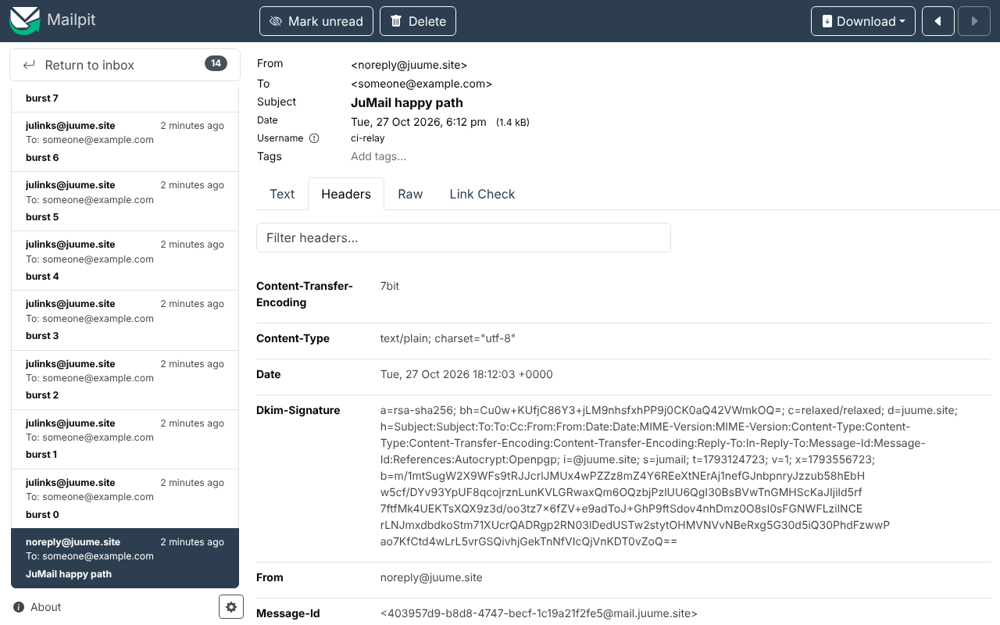

# JuMail

Send-only SMTP relay for the apps under one domain. Each app gets its own
login on port 587; the relay authenticates it, enforces which From addresses
it may use, DKIM-signs the message, queues it and forwards it to a
transactional provider (Resend by default) over authenticated STARTTLS.

Built on [maddy](https://maddy.email) 0.9, configured as a submission-only
server: no port 25, no IMAP, no mailboxes.

## Why a relay

A home connection cannot deliver mail directly. ISPs block outbound port 25
and residential IP ranges are listed on the Spamhaus PBL, so Gmail and Outlook
reject them. The relay keeps identity, credentials, signing, policy and the
queue on your own host and uses a provider only for the final hop.

```
 app A ─┐                                     ┌─────────────────────┐
 app B ─┤ 587 STARTTLS, one login per app     │ JuMail (maddy)      │ 587 STARTTLS + AUTH  ┌──────────┐
 app C ─┼───────────────────────────────────▶ │ auth · From policy  │ ───────────────────▶ │ provider │ ──▶ recipient
 app D ─┘ docker network "jumail"             │ DKIM · rate · queue │                      └──────────┘
                                              └─────────────────────┘
```

## Features

- Submission on 587 only. AUTH is not advertised before STARTTLS; TLS 1.2+.
- One bcrypt-hashed login per app, stored in an SQLite table in the data volume.
- Per-login allow-list of From addresses (`config/senders`), checked on both
  the envelope and the header. Senders outside the domain are rejected.
- DKIM signing with a 2048-bit RSA key generated on first start.
- Global rate limit; excess is deferred with 451, not dropped.
- On-disk queue with exponential retry when the provider is unreachable.
- TLS certificate from Let's Encrypt (DNS-01 via Cloudflare) or from files.
- Hardened container: non-root, read-only filesystem, no capabilities,
  `no-new-privileges`, 10 MB message cap, log rotation.
- No port published beyond `127.0.0.1`; apps reach it over a docker network.
- Operator CLI (`./jumail`) for logins, DNS records, queue and test mail.
- End-to-end smoke test with Mailpit standing in for the provider.

## Requirements

- Docker Engine with Compose v2.
- A domain whose DNS you control (Cloudflare for the ACME option).
- A provider account with SMTP relay access. Resend's free plan works
  (100 mails/day, 3000/month, no card); Brevo, Mailjet, SMTP2GO and others
  are a change of four `.env` values.

## Quick start

```bash
git clone https://github.com/adev0x3b/jumail.git && cd jumail
./jumail init                 # creates .env from .env.example
# edit .env: RELAY_PASSWORD (Resend API key), ACME_EMAIL, CLOUDFLARE_API_TOKEN
./jumail up                   # starts the relay and obtains the certificate
./jumail dns                  # DNS records to publish
./jumail user add myapp myapp@example.com noreply@example.com
./jumail test you@example.org noreply@example.com myapp
```

Add the domain at the provider first (Resend asks for three records), then
publish the records printed by `./jumail dns`.

## Configuration

All settings are in `.env` (never committed; see `.env.example`).

| key | default | meaning |
|---|---|---|
| `JUMAIL_HOSTNAME` | `mail.juume.site` | server name; also the docker network alias apps connect to |
| `JUMAIL_DOMAIN` | `juume.site` | the only sender domain accepted |
| `JUMAIL_DKIM_SELECTOR` | `jumail` | DKIM selector |
| `JUMAIL_TLS` | `acme` | `acme` (Let's Encrypt via Cloudflare DNS-01) or `selfsigned` (files from `./jumail certs`) |
| `ACME_EMAIL`, `CLOUDFLARE_API_TOKEN` | | ACME contact; token scoped to *Zone › DNS › Edit* on the one zone |
| `RELAY_HOST`, `RELAY_PORT` | `smtp.resend.com`, `587` | upstream provider |
| `RELAY_USER`, `RELAY_PASSWORD` | `resend`, | provider SMTP credentials (Resend: the API key) |
| `RELAY_SPF_INCLUDE` | empty | provider's SPF include for the root domain, if it needs one (Brevo: `spf.brevo.com`) |
| `JUMAIL_RATE_BURST`, `JUMAIL_RATE_PERIOD` | `20`, `1h` | global sending budget |
| `JUMAIL_LOOPBACK_PORT` | `587` | port published on `127.0.0.1` for clients outside docker |

The policy itself is `config/maddy.conf`. `config/site-acme.conf` and
`config/site-selfsigned.conf` hold the TLS source and the upstream target and
are selected by `JUMAIL_TLS`.

### TLS modes

- `acme` (default): a real certificate for `JUMAIL_HOSTNAME`, renewed
  automatically. Apps need no TLS configuration.
- `selfsigned`: `./jumail certs` creates a local CA and server certificate in
  `certs/`. Apps must trust `certs/ca.pem` (`NODE_EXTRA_CA_CERTS`, `ca_file`,
  `SSL_CERT_FILE`, ...).

## DNS records

`./jumail dns` prints them with the actual values. With Resend and the
defaults:

| name | type | value | from |
|---|---|---|---|
| `send.juume.site` | MX | `feedback-smtp.<region>.amazonses.com`, priority 10 | Resend |
| `send.juume.site` | TXT | `v=spf1 include:amazonses.com ~all` | Resend |
| `resend._domainkey.juume.site` | TXT | `p=...` | Resend |
| `jumail._domainkey.juume.site` | TXT | `v=DKIM1; k=rsa; p=...` | `./jumail dkim` |
| `_dmarc.juume.site` | TXT | `v=DMARC1; p=quarantine; adkim=s; aspf=r` | `./jumail dns` |

All DNS-only in Cloudflare. Resend puts the return path on `send.juume.site`,
so the root domain needs no SPF change; a provider that sends with the root
domain as return path (Brevo) needs `v=spf1 include:<its include> -all` there,
set `RELAY_SPF_INCLUDE` and `./jumail dns` prints it.

## Connecting an app

Join the external `jumail` network and use the login printed by
`./jumail user add`: host `mail.juume.site`, port 587, STARTTLS, PLAIN or
LOGIN authentication.

```yaml
# compose.yml of an app on the same docker host
services:
  web:
    environment:
      SMTP_HOST: mail.juume.site
      SMTP_PORT: 587
      SMTP_USER: myapp
      SMTP_PASSWORD: ${SMTP_PASSWORD}
      MAIL_FROM: noreply@juume.site
    networks: [default, jumail]
networks:
  jumail:
    external: true
```

<details><summary>Client examples</summary>

```js
// Node (nodemailer)
nodemailer.createTransport({ host: "mail.juume.site", port: 587, secure: false, requireTLS: true,
  auth: { user: process.env.SMTP_USER, pass: process.env.SMTP_PASSWORD } });
```

```ruby
# Rails
config.action_mailer.smtp_settings = { address: "mail.juume.site", port: 587,
  user_name: ENV["SMTP_USER"], password: ENV["SMTP_PASSWORD"],
  authentication: :plain, enable_starttls: true }
```

```python
# Python
s = smtplib.SMTP("mail.juume.site", 587); s.starttls(context=ssl.create_default_context())
s.login(user, password); s.send_message(msg)
```

```csharp
// .NET (MailKit)
await client.ConnectAsync("mail.juume.site", 587, SecureSocketOptions.StartTls);
await client.AuthenticateAsync(user, password);
```
</details>

Containers that are not managed by Compose (for example Kamal deployments)
can be attached with `docker network connect jumail <container>`, or can use
the loopback port on the host.

## Operations

| command | |
|---|---|
| `./jumail user add NAME [ADDR...]` | create a login; prints the password once |
| `./jumail user passwd NAME` | new random password |
| `./jumail user rm NAME` / `user list` | revoke, inspect |
| `./jumail dns` / `./jumail dkim` | records to publish |
| `./jumail logs` / `queue` / `status` | runtime state |
| `./jumail test TO [FROM] [LOGIN]` | send a test message through the relay |
| `git pull && ./jumail up` | update |

The allow-list file reloads within 15 seconds; logins take effect
immediately. Rotating the provider key is a change to `.env` followed by
`./jumail up`. The queue retries 12 times with exponential back-off starting
at about 18 minutes; failures are logged, no bounce messages are generated
because there is no mailbox to deliver them to.

## Testing

`ci/` runs the complete chain with Mailpit as the upstream (STARTTLS and
authentication required) and `ci/smoke.py` checking the policy from a client's
point of view:

```bash
./ci/gen-certs.sh
export COMPOSE_FILE=compose.yml:ci/compose.ci.yml
docker compose up -d --wait jumail mailpit
./jumail user add julinks --password julinks-ci-secret --no-senders
./jumail user add jupdf --password jupdf-ci-secret --no-senders
docker compose run --rm smoke
docker compose down -v
```

Checks: AUTH hidden before STARTTLS, unauthenticated send refused, wrong
password refused, From outside the allow-list refused, foreign sender domain
refused, spoofed header From refused, authenticated send accepted, message
relayed upstream over STARTTLS with AUTH, DKIM signature present with the
expected domain and selector, From preserved, one login cannot use another's
address, rate limit defers with 451. The GitHub Actions workflow runs the same
on every push.



## Limitations

- Rate limits are global, not per login (maddy scopes limits by IP, sender
  domain or destination, and all logins share one domain).
- The provider sees message contents.
- No inbound mail, no bounces, no DMARC reports.

## Layout

```
compose.yml                  relay service, network "jumail", data volume
config/maddy.conf            listener, authentication, sender policy, DKIM, queue
config/site-acme.conf        TLS via Let's Encrypt + upstream relay
config/site-selfsigned.conf  TLS from files + upstream relay
config/senders               login -> allowed From addresses
jumail                       operator CLI
ci/                          Mailpit stand-in, smoke test, compose override, cert generator
.github/workflows/ci.yml     runs the smoke test
```

## License

MIT
